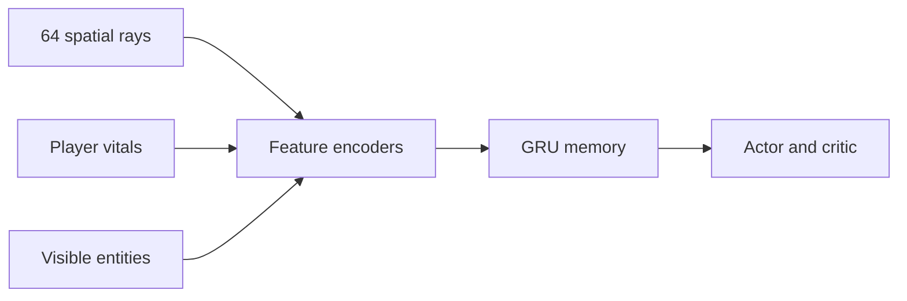

<div align="center">

# ◢ AGENT DOOM ◣

**YUGAANTAR 2026 · DEVFORGE · TRACK 1**  
*Can It Play DOOM?*


<br />


[](https://github.com/ashfaqhyder/agent-doom/commit/0c0005efc78f9ea443e4eea839cae6b8036ac4b5)


[Quickstart](#quickstart) · [Architecture](#architecture) · [Results](#results) · [Repository guide](#repository-guide)

</div>

---

Agent DOOM is a recurrent reinforcement learning agent for ViZDoom. It uses local geometry, player vitals, and visible entities to choose an action. The DevForge challenge is to survive encounters, navigate unfamiliar rooms, find keycards, unlock doors, and reach the exit on unseen layouts.

Built from the [official DevForge DOOM starter](https://github.com/Reinforce-SST/devforge-doom-template).

> [!NOTE]
> The default `ppo_smoke.pt` checkpoint received **two PPO updates over 32 game decisions**. It passed the official validator from a fresh Windows clone of [`0c0005e`](https://github.com/ashfaqhyder/agent-doom/commit/0c0005efc78f9ea443e4eea839cae6b8036ac4b5) and reached the 525-decision tick cap on the bundled verification map.

## Quickstart

Install Git LFS and [uv](https://docs.astral.sh/uv/). The project targets **Python 3.13**.

```bash
git clone https://github.com/ashfaqhyder/agent-doom.git
cd agent-doom
git lfs pull
uv sync --frozen
uv run python validate.py
```

<details>
<summary><strong>Windows console encoding fix</strong></summary>

If PowerShell reports a console encoding error, rerun the validator with UTF-8 output.

```powershell
$env:PYTHONIOENCODING = 'utf-8'
uv run python validate.py
```

</details>

<details>
<summary><strong>Validate with Docker</strong></summary>

With the Docker Linux engine running, build the starter image or use the organizer-provided image tag.

```bash
docker build -t devforge-doom .
uv run python validate.py --docker --image devforge-doom
```

The evaluation budget is **2 GB VRAM, 8 GB RAM, and one CPU thread**. CPU affinity and peak RAM remain unverified on Windows. Docker validation is pending.

</details>

## Architecture



| Component | Role |
|---|---|
| **Spatial encoder** | Processes player-relative ray distances and hit types to represent nearby geometry. |
| **Vitals encoder** | Processes the 17-value player state, including health, ammo, and keycard flags. |
| **Entity encoder** | Uses masked pooling to summarize visible entities and handles empty observations. |
| **GRU memory** | Carries information between decisions and resets at the start of each episode. |
| **Actor–critic** | The actor selects controls. The critic estimates expected return during PPO training. |

The default policy thresholds nine button logits to produce the official binary action vector. Experimental categorical policies choose from 15 compatible button combinations and convert the selected combination to the same nine-button format.

### Training

Experiments used recurrent PPO with ordered rollouts and tested exploration bonuses, door-opening and crossing curricula, exit practice, and a training-only health-loss penalty. The multi-map run trained on Freedoom2 `MAP03`–`MAP06` and reserved `MAP01` and `MAP02` for evaluation.

[Training commands and experiment notes](training/README.md)

## Results

| Evaluation | Result |
|---|---|
| **Fresh-clone validation** | The official Windows validator passed with the default Git LFS checkpoint and no inference overrides. |
| **Doorway crossing** | The sampled open-door checkpoint crossed in **10/20** original-spawn episodes on `two_rooms`. Uniform random crossed in **5/20**. |
| **Exit behavior** | A sampled health-aware checkpoint reached **1/10** exits on a fresh `two_rooms` seed set. |
| **Reserved maps** | All tested policies recorded **zero exits** in the paired Freedoom2 `MAP01` and `MAP02` comparison. The default survived every episode and averaged two sectors per map. |

The experimental checkpoints showed progress on `two_rooms`. Reliable exits on unseen layouts remain an open goal.

## Repository guide

| Path | Contents |
|---|---|
| [`submission/agent.py`](submission/agent.py) | `DoomAgent` inference entry point |
| [`submission/weights/`](submission/weights/) | Default checkpoint tracked through Git LFS |
| [`training/`](training/) | PPO trainer, evaluation code, and experiment notes |
| [`env/`](env/) | Official ViZDoom Gymnasium wrapper |
| [`maps/`](maps/) | Bundled `two_rooms.wad` verification map |
| [`validate.py`](validate.py) | Official local submission validator |
| [`tests/`](tests/) | Agent, training, and template tests |

### Official track documentation

[Agent contract](docs/CONTRACT.md) · [Rules](docs/RULES.md) · [Submission checklist](docs/SUBMISSION.md) · [Evaluation and scoring](docs/EVALUATION.md)

The scorer uses the frozen wrapper, vanilla engine rules, and unseen maps. Inference uses the official observations, with gameplay decisions driven by trained parameters. Submissions use a public GitHub repository, store weights through Git LFS, and stay within the **1 GB** repository limit.
